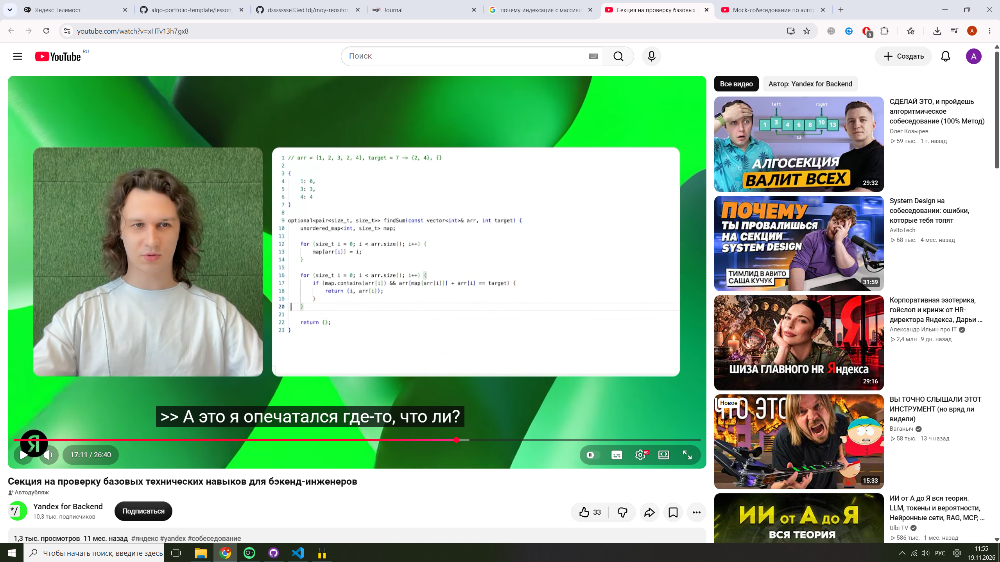
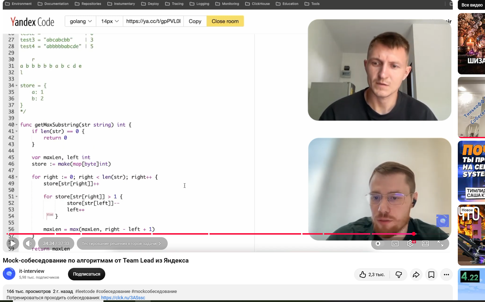

# Домашняя работа № 6 · Как проходит алгоритмическое собеседование

**Дисциплина:** ОП.04 «Основы алгоритмизации и программирования»

| Поле | Значение |
|---|---|
| Фамилия, имя, отчество | Клейновский Максим Андреевич  |
| Группа | 9/3-РПО-24/2 |
| Номер работы | 6 |
| Тема работы | Разбор двух записей алгоритмических собеседований |
| Дата сдачи | 19.11 |
| Ветка | `hw-06` |

Часть ответов уже написана. Замените `___` своими ответами, одной-двумя фразами.

---

## 1. Видео A · Показательная секция Яндекса

### 1.1. Как устроена секция (около 1:00–3:30)

Час, две задачи, главное — корректность. Код пишут в редакторе без запуска.
Работа над задачей идёт по шагам: записать условие, предложить алгоритм,
оценить время и память, написать код, сдать и проверить.

Что из этих шагов кандидат должен сделать до того, как начнёт писать код,
и зачем интервьюеру это нужно:  записываем условие, описать алгоритм, обговариваем сложность и память и пишем код, также задавать вопросы. Это надо чтобы интервьюер мог поправить человека в начале. 

### 1.2. Два решения Two Sum (около 6:30–10:30)

Задача — LeetCode 1, мы решали её на занятии 17.

| | Первое решение | Второе решение |
|---|---|---|
| Идея | сортировка, затем два указателя с краёв | сохранить число в словарь, а потом искать пару|
| Время и память | O(n log n), O(n) | O(n) и O(n)  |

Почему интервьюер попросил подумать ещё, хотя первое решение верное: он ъхотел увидеть более ёмкое решение, незатратное по памяти

### 1.3. Ошибка около 20:00

Какую ошибку нашли и на каком тесте: на массиве из 1 элемента алгоритм взял одно и тоже число и вернул пару индексов таких же

На занятии 17 мы сначала ищем пару для числа и только потом кладём число
в словарь. Почему в таком порядке эта ошибка невозможна: элемента еще нету в словаре в момент поиска

---

## 2. Видео B · Мок-собеседование с тимлидом

### 2.1. Объединение интервалов (около 4:00–16:30)

Задача — LeetCode 56, модуль 12. Кандидат сначала назвал сложность линейной.
Что он не учёл и какая сложность верная: не учёл сортировку интервалов. а сложность по вермени O(n log n) и по памяти O(n)

На каком входе код сломался и почему: на пустом списке, он попытался сразу обратится к первому элементу массива чтобы положить результат

### 2.2. Самая длинная подстрока без повторов (около 17:00–26:30)

Задача — LeetCode 3, модуль 10.

Первое решение кандидата проверяло каждую подстроку заново. Как он ускорил
его до O(n): два указателя он применил и хеш-таблицу, обновляя счётчики за O(1) при свдиге границ вместо обхода строки

Почему память O(1), а не O(n), как кандидат сказал сначала: размер хеш-таблицы ограничен кол-вом уникальных символов поэтому память не растет бесконечно с ростом длины строки

### 2.3. Отзыв интервьюера (около 35:00)

Хорошо: кандидат проговаривает ход мысли, его легко поправить.
Над чем работать (две вещи): уточнять условия и требования, а также продумывать луччше тест-кейсы

---

## 3. Мои правила на собеседование

Два правила, которые вы возьмёте себе. Каждое подкрепите моментом из видео.

| Правило | Момент из видео |
|---|---|
| до кода спросить, может ли вход быть пустым | видео B, 15:30: код сломался на пустом списке интервалов |
| проверять рещение на массиве из 1 элемента | в видео первом алгоритм вернул два одинаковых индекса 1 и того же элемента |
| уточнять состав входных данных | в видео втором кандидат не спрросил про регистр букв и уточнил про ASCII в конце только |

---

ИИ: использовал для проверки своих ответов
